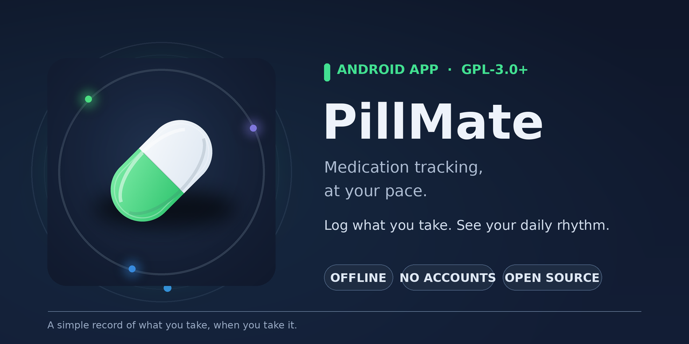

<h1 align="center">PillMate</h1>

<p align="center">English · <a href="README.md">Español</a></p>

<p align="center">
  
</p>

> Log each dose **when you need it** and discover your own patterns, without a fixed schedule.
>
> **No required alarms · No accounts · No internet access.**

<p align="center">
  
  
  
  
</p>

<p align="center">
  
  
  
  
</p>

<p align="center"><sub>Screenshots use sample data and show the Spanish interface.</sub></p>

---

**Contents:** [What it is](#what-it-is) · [Features](#features) · [Privacy](#privacy) · [What it is not](#what-it-is-not) · [Install](#install) · [Build](#build) · [How it works](#how-it-works) · [Contribute](#contribute) · [Support](#support) · [License](#license)

## What it is

PillMate is an Android app for **on-demand medication logging**: medication you take when you need it, not on a fixed schedule. Log each dose with one tap, then see your own pattern: when you take it, how much, and how far apart.

It is not an alarm-based pill reminder. Reminders are available, but optional.

Three principles guide the app:

1. **It works offline.** It does not just avoid the internet; it has no permission to use it.
2. **Logging takes one tap.** If logging is slower than skipping it, people will skip it.
3. **It describes, it does not judge.** It shows what you logged. It does not score adherence, set goals, or give advice.

> **Status:** `2.0.0-beta.2` is the latest public release. It works and is used daily, but has only been tested on a small number of devices. If something breaks, please open an issue. Download the APK from [Releases](https://github.com/D4vRAM369/PillMate/releases/latest); PillMate is not on Google Play yet.

## Features

### Log doses

- **One tap.** Four quick actions on the home screen. Long-press to change the amount or time. If you make a mistake, undo it.
- **Without opening the app.** Use a home-screen widget or a persistent notification to log a dose.
- **A widget that fits your setup.** Resize it to 2×2, a row, or a column. Choose from three shapes, three densities, and eight colors.
- **Notes.** Add a text note to a dose or record an encrypted voice note.

### See your pattern

- **24-hour clock.** Each dose appears as a dot in its medication's color. A day shows the exact time; a week or month groups doses by hour. Tap a dot or bar to see what was logged.
- **Your pattern in numbers.** See your most active hour, usual interval between doses, most logged medication, and day with the most doses. These insights use arithmetic, not AI.
- **Medication statistics.** See daily amounts (mg, ml, drops) and dose counts, with strengths of the same medication grouped together.
- **History.** Browse by day, week, or month, and search notes.

### Your data

- Create a restorable **ZIP backup**, or export to **CSV** or **PDF**.
- Optionally lock the app with biometrics.

### More

- **Interactive introduction:** four short, tappable pages the first time you open the app. You can replay them from Settings.
- **Two designs:** *Rhythm* and *Classic*, with light, dark, and Material You themes.

## Privacy

PillMate **has no internet permission**. It cannot send your data anywhere. An automated test checks that the final app package does not include internet access ([`PrivacyContractTest`](app/src/test/java/com/d4vram/pillmate2/ai/PrivacyContractTest.kt)).

- No accounts, analytics, ads, or third-party services.
- Data stays on your device. It leaves only when you choose to export it.

Permissions and why the app uses them:

| Permission | Purpose |
|---|---|
| Notifications, exact alarms, startup | Optional reminders and the quick-dose notification |
| Microphone | Voice notes |
| Camera and photos | Medication photos |
| Biometrics | App lock |

## What it is not

PillMate describes what you log; it **does not give medical advice**. It does not calculate maximum doses, check interactions, or score your adherence. It is not a medical device. Decisions about your medication remain between you and your prescriber.

## Install

1. Download the latest APK from [Releases](https://github.com/D4vRAM369/PillMate/releases/latest).
2. Open it on your phone. Android will ask you to allow installs from that source, such as your browser or file manager.
3. Open PillMate. The introduction covers the basics in about a minute.

Requires Android 8.0 or later.

**Updates.** PillMate has no internet access, so it cannot notify you about new versions. Check [Releases](https://github.com/D4vRAM369/PillMate/releases) or use [Obtainium](https://github.com/ImranR98/Obtainium) to watch this repository. Updating preserves your data.

**Before updating or changing phones**, create a backup from Settings → Data.

## Build

You need Android Studio (or the Android SDK) and JDK 17 or later.

```bash
git clone https://github.com/D4vRAM369/PillMate.git
cd PillMate
./gradlew :app:assembleDebug        # build
./gradlew :app:testDebugUnitTest    # run unit tests
```

To install a separate development build alongside your regular app, use the `-Pdev` variant:

```bash
./gradlew :app:assembleDebug -Pdev
adb install --user 0 -r app/build/outputs/apk/debug/app-debug.apk
```

The development build uses the application ID `dev.d4vram.pillmate2` and has its own database.

To build a signed release, add a local, untracked `keystore.properties` file in the project root with `storeFile`, `storePassword`, `keyAlias`, and `keyPassword`.

## How it works

Kotlin · Jetpack Compose and Material 3 · Room · DataStore · Glance (widget) · Navigation Compose. Minimum Android version: API 26 (Android 8.0); compiled against Android 15 (API 35).

The app has one module and follows MVVM: Compose screens, `ViewModel`s with `StateFlow`, a repository, and Room underneath.

```
app/src/main/java/com/d4vram/pillmate2/
├── data/            Room (entities, DAOs, migrations), repository, backup and export
├── model/           Models used by the interface
├── ai/              SmartInsightEngine: arithmetic-based patterns, despite the name
├── notifications/   Reminders and the quick-dose notification
├── widget/          Home-screen widget (Glance)
└── ui/
    ├── screens/     Home, medications, history, statistics, notes, settings
    ├── timeline/    24-hour clock
    ├── onboarding/  Introduction
    └── theme/       Themes, designs, and preferences
```

The Room schema is exported to [`app/schemas/`](app/schemas) so migrations can be checked.

## Contribute

Bug reports and ideas are welcome. Before suggesting a feature, keep the three principles above in mind—and one more: the app does not use AI.

For code changes, run `./gradlew :app:testDebugUnitTest`. Do not include real medication data in examples, screenshots, or tests.

## Support

PillMate is free and will stay free, with no ads or in-app purchases. If you find it useful and would like to buy me a coffee:

<a href="https://www.buymeacoffee.com/D4vRAM369"></a>

## License

Copyright © 2025–2026 D4vRAM369

PillMate is free software: you may redistribute and modify it under the terms of the [GNU General Public License, version 3](LICENSE), or any later version. It is distributed in the hope that it will be useful, but **without any warranty**.

In short: you can use it, study it, change it, and share it. If you distribute a modified version, it must remain free under this same license.
