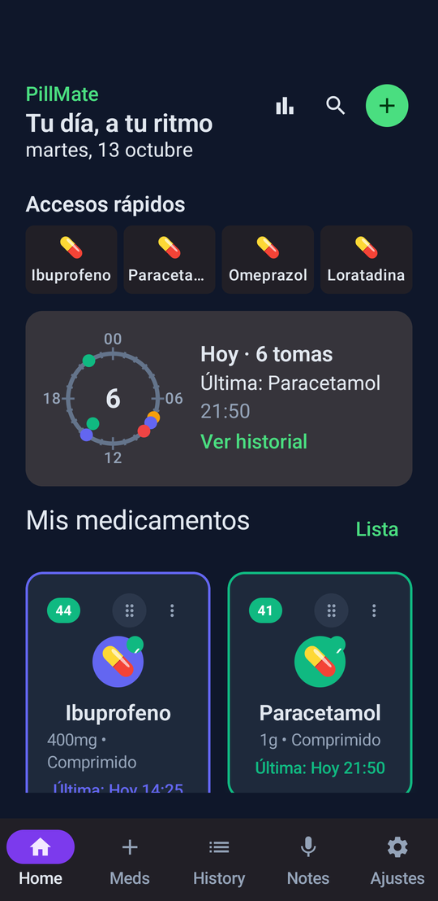
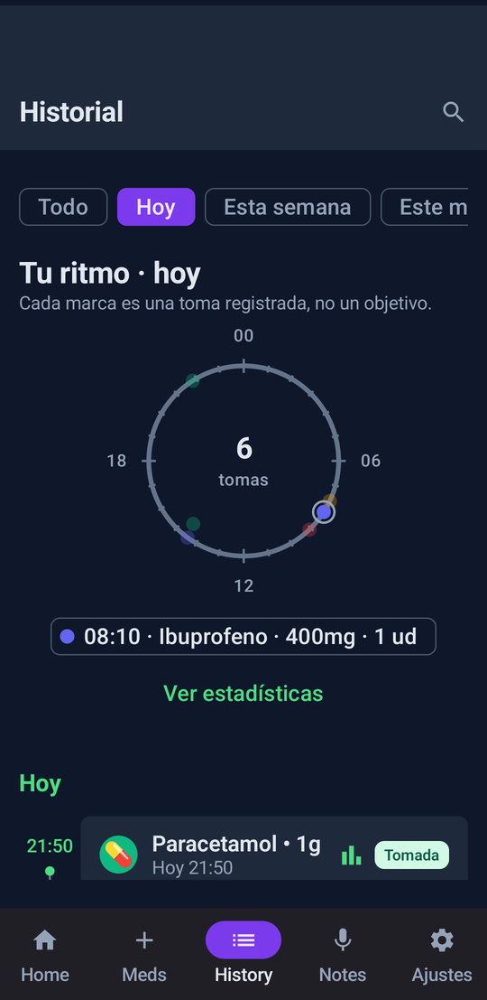
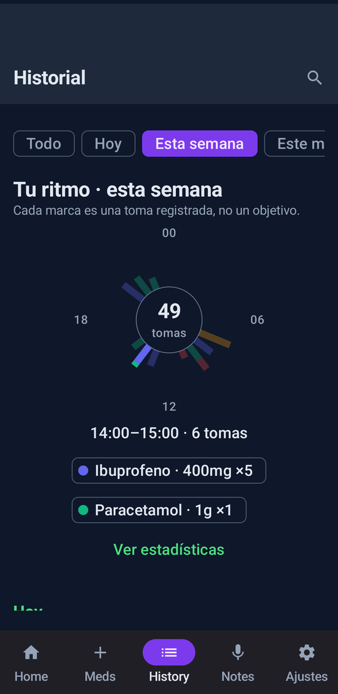
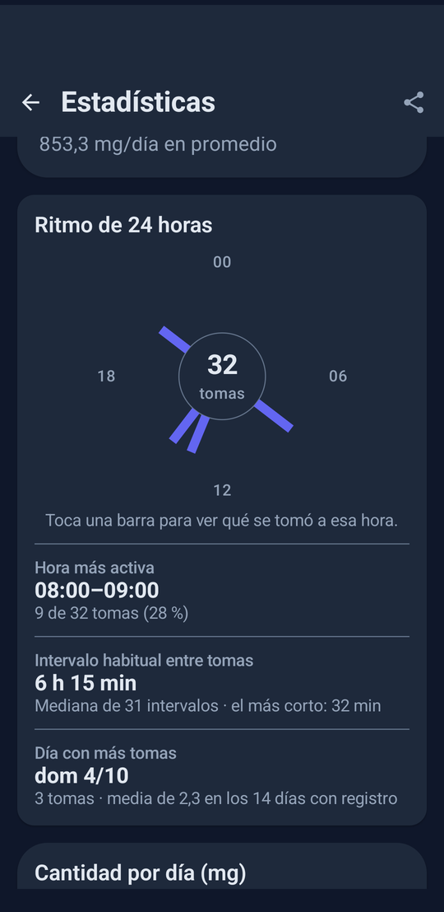

<p align="center">
  
</p>

<h1 align="center">PillMate</h1>

<p align="center">
  Registra la medicación que tomas <b>cuando la tomas</b> y descubre tu propio ritmo.<br>
  Sin alarmas que te persigan. Sin cuentas. Sin internet.
</p>

<p align="center">
  
  
  
  
</p>

<p align="center"><sub>Capturas con datos de ejemplo.</sub></p>

---

## Qué es

PillMate es una app Android para medicación **a demanda**: la que tomas cuando la necesitas, no a una hora fija. Apuntas cada toma con un toque y la app te devuelve tu patrón: a qué horas, cuánto y con qué separación.

No es un pastillero de alarmas. Los recordatorios existen, pero son opcionales.

> **Estado:** `2.0.0-alpha`. Se usa a diario, pero todavía cambia. Todavía no está en Google Play.

## Qué hace

- **Registro en un toque.** Cuatro accesos rápidos en la pantalla principal, un widget 2×2 y una notificación persistente. Si te equivocas, *Deshacer*.
- **Reloj de 24 horas.** Cada toma es un punto con el color de su medicamento. Con un día ves el momento exacto; con una semana o un mes, a qué horas se concentran. Toca un punto o una barra para ver qué fue.
- **Tu patrón, en números.** Hora más activa, intervalo habitual entre tomas, medicamento más registrado y día con más tomas. Calculado con aritmética, sin IA.
- **Estadísticas por medicamento.** Cantidad por día (mg, ml, gotas) y número de tomas, con las distintas dosis de un mismo medicamento agrupadas.
- **Notas.** De texto en cada toma, y de voz cifradas.
- **Tus datos, contigo.** Copia de seguridad completa en ZIP, exportación a CSV y a PDF.
- **Bloqueo biométrico** opcional.
- **Dos diseños:** *Ritmo* (el nuevo) y *Clásico*, con tema claro, oscuro y Material You.

## Privacidad

La app **no tiene permiso de internet**. No puede enviar nada a ningún sitio, y hay un test que falla si alguien se lo añade ([`PrivacyContractTest`](app/src/test/java/com/d4vram/pillmate2/ai/PrivacyContractTest.kt)).

- Sin cuentas, sin analítica, sin publicidad, sin servicios de terceros.
- Todo se guarda en el dispositivo. Las copias salen solo cuando tú las exportas.

Permisos que sí pide, y para qué:

| Permiso | Para qué |
|---|---|
| Notificaciones, alarmas exactas, arranque | Recordatorios opcionales y notificación de toma rápida |
| Micrófono | Notas de voz |
| Cámara y fotos | Foto del medicamento |
| Biometría | Bloqueo de la app |

## Lo que no es

PillMate describe lo que registras; **no da consejo médico**. No calcula dosis máximas, no avisa de interacciones y no puntúa tu "adherencia". No es un producto sanitario. Las decisiones sobre tu medicación son tuyas y de quien te la prescribe.

## Compilar

Necesitas Android Studio (o el SDK de Android) y JDK 17 o superior.

```bash
git clone https://github.com/D4vRAM369/PillMate.git
cd PillMate
./gradlew :app:assembleDebug        # compila
./gradlew :app:testDebugUnitTest    # tests unitarios
./gradlew :app:installDebug         # instala en un dispositivo conectado
```

La variante `debug` se instala como **PillMate Dev** (`dev.d4vram.pillmate2`), una app aparte con su propia base de datos: puedes probar cambios sin tocar tus datos reales.

Para compilar `release` hace falta un `keystore.properties` en la raíz (no se versiona) con `storeFile`, `storePassword`, `keyAlias` y `keyPassword`.

## Tecnología

Kotlin · Jetpack Compose y Material 3 · Room · DataStore · Glance (widget) · Navigation Compose. Mínimo Android 8.0 (API 26).

Un solo módulo, arquitectura MVVM: pantallas en Compose, `ViewModel` con `StateFlow`, un repositorio y Room debajo.

## Contribuir

Los *issues* con fallos o ideas son bienvenidos. Antes de proponer una función, ten en cuenta tres principios que no son negociables: la app funciona sin internet, no usa IA y no juzga al usuario.

## Licencia

Copyright © 2025-2026 D4vRAM369

PillMate es software libre: puedes redistribuirlo y modificarlo bajo los términos de la [GNU General Public License, versión 3](LICENSE) o, si lo prefieres, cualquier versión posterior. Se distribuye con la esperanza de que sea útil, pero **sin ninguna garantía**.

En corto: puedes usarla, estudiarla, cambiarla y compartirla. Si distribuyes una versión modificada, tiene que seguir siendo libre y bajo esta misma licencia.
